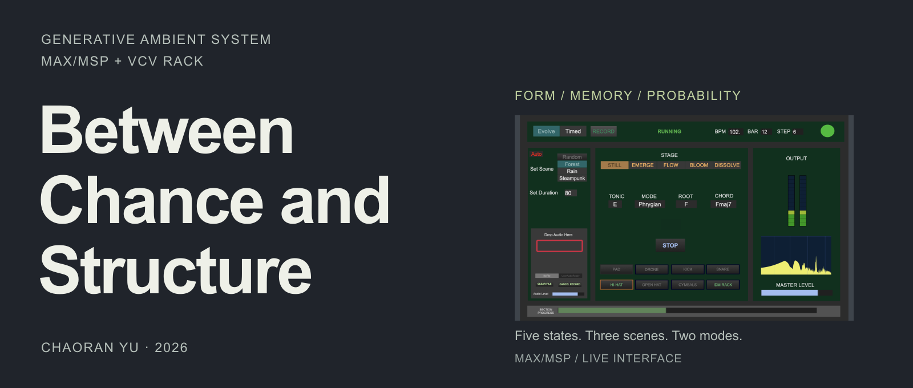
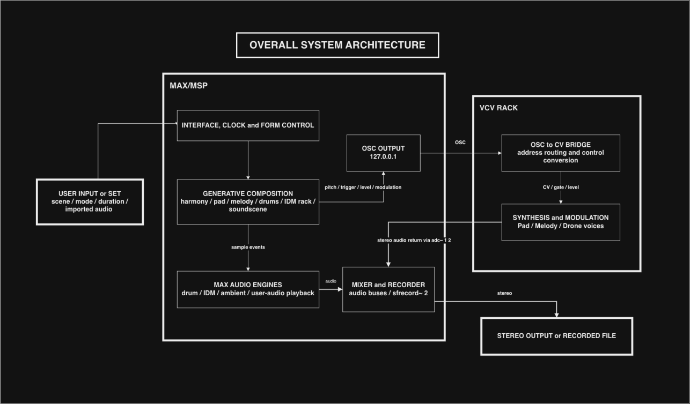

**English** · [简体中文](README.zh-CN.md)

[](docs/visuals/max-presentation.png)

**Designing a Generative System for Ambient Music**

A generative ambient and lo-fi music system shaped by probability, section memory and a
five-state formal model.

[**Watch the demo ↗**](https://drive.google.com/file/d/17yuBqAit3PdmheTKZqrVmPnGPdnH5vLY/view?usp=sharing) · [**Listen ↗**](https://drive.google.com/file/d/1ApeeHdoXmLhVu1l2J4Wy0cETJyLGmT0u/view?usp=sharing) · [**Read the report**](REPORT.pdf) · [**Run it**](#run-it)

Chaoran Yu · MSc Sound Design, University of Edinburgh · August 2026

<details>
<summary>All demonstrations, technical walkthroughs and recordings</summary>

Long videos and audio examples are hosted on Google Drive rather than stored here.

| Material | File | Link |
|---|---|---|
| Formal demonstration of the system in operation | `RunTime.mov` | [Watch on Google Drive](https://drive.google.com/file/d/17yuBqAit3PdmheTKZqrVmPnGPdnH5vLY/view?usp=sharing) |
| Technical walkthrough of the Max/MSP and VCV Rack architecture | `Technical_Walkthrough.mov` | [Watch on Google Drive](https://drive.google.com/file/d/1eXBOXYaxDb0hraimLBJQ85Wr6R3nL45d/view?usp=sharing) |
| 25-minute continuous Evolve-mode run | `Evolve_mode_LongTime.mov` | [Watch on Google Drive](https://drive.google.com/file/d/1TPtyGSVmoVBKu10N4AeWZmzZfzc1u64b/view?usp=drive_link) |
| Session recording, 18 August 2026 | `2026-08-18_20-17-12.mov` | [Watch on Google Drive](https://drive.google.com/file/d/1lAIslc-TdbG9T7EG_hM_DVU6XcVMcxPY/view?usp=drive_link) |
| Audio example — Evolve-mode run | `EvolveMode_run.wav` | [Listen on Google Drive](https://drive.google.com/file/d/1ApeeHdoXmLhVu1l2J4Wy0cETJyLGmT0u/view?usp=sharing) |
| Audio example — user-audio import test | `Example_User_Audio_glasglow_dji.wav` | [Listen on Google Drive](https://drive.google.com/file/d/16VR578T4fc08Mcy-_fuDGXkPomc4d_qU/view?usp=sharing) |

All links are set to *anyone with the link can view*.

</details>

## What I built

- A five-state formal controller with Evolve and Timed modes, section memory and orchestration rules.
- Hand-authored harmonic transition tables, weighted choices and a minimum-movement voice-leading cost function.
- Melody and drum phrase memory, conditional IDM percussion, scene-based soundscapes, and OSC integration with VCV Rack.

## How it works

The project asks how far probability can vary local musical events before the larger form
becomes difficult to follow. Continuity comes from authored rule tables, weighted choices and
section memory; change comes from orchestration and the passing of formal states.

**Five formal states**, advanced by a leave-probability test at each section boundary:

`STILL (0) → EMERGE (1) → FLOW (2) → BLOOM (3) → DISSOLVE (4)`

**Three scenes**, distinguished mainly by their samples and tempo pools: Forest, Rain,
Steampunk.

**Two modes** — *Evolve* runs without a fixed endpoint; *Timed* takes a duration (60–600 s),
places the five states before the endpoint and stops itself.

Harmony uses hand-authored first-order Markov chains, weighted `coll` pools and a voice-leading
cost function; melody, drums and environmental events are driven by their own subpatches.
The report (sections 4.3–4.5) covers the architecture in full; the diagrams are in
[`docs/architecture/`](docs/architecture/).

## System architecture

<details>
<summary>View the system architecture and audio routing</summary>



One Max/MSP patch composes harmony, melody, drums and soundscape events. Max sends OSC
control data to VCV Rack for pitched synthesis; the stereo audio returns to Max through BlackHole.

</details>

## Run it

1. Install **Max 9.1.4** and **VCV Rack 2.6.6**, plus the VCV plugins listed under
   [Requirements](#requirements).
2. Supply replacement audio using the [sample guide](patch/bpatch_and_samples/samples/README.md).
   The sample folders ship empty; the scene and IDM pools require specific buffer groups.
3. Open `vcv/Between_Chance_and_Structure.vcv`; set its Audio Interface to **BlackHole 16ch**,
   48 kHz, 256-sample block.
4. Open `patch/Between_Chance_and_Structure.maxpat`; set Max input to **BlackHole 16ch** and
   output to your physical device.
5. Enable audio in Max, choose a scene and mode, then press **START**.

Do not route the Max output back into BlackHole — that produces feedback or silence. The full
operating manual, interface reference and recording workflow are in
[`docs/setup-guide.md`](docs/setup-guide.md). Use the [manual verification checklist](docs/verification.md)
to check a fresh setup.

## Requirements

Developed on macOS. Author-provided environment: macOS Tahoe 26.6.2, 16-inch MacBook Pro,
Apple M5 Pro, 64 GB RAM. See the [environment and saved plugin versions](docs/environment.md).
Windows and Linux routing have not been verified for this project.

- **Max 9.1.4** (developed and tested on this version)
- **VCV Rack 2.6.6** with these plugins from the VCV Library: 4ms-ROMplers, 4msCompany,
  ALMFree, AlrightDevices, Befaco, Bogaudio, DrumKit, HetrickCV, MindMeldModular, NYSTHI,
  Submit, SurgeXTRack, Valley, Venom, trowaSoft
- **BlackHole 16ch** (or an equivalent virtual audio device) to return VCV Rack audio to Max
- A physical audio output — headphones, speakers or an audio interface

## The written report

[](REPORT.pdf)

[**Between Chance and Structure — project report (PDF, 59 pages)**](REPORT.pdf)

The report is the main written document: motivation and related practice, the authored rule
system, the five-state formal model, the Max/MSP and VCV Rack implementation, listening,
reflection, and three appendices (AI-use statement, third-party materials, probability and
mapping tables).

## Repository layout

<details>
<summary>View the repository tree</summary>

```
README.md                     This page
README.zh-CN.md               Simplified Chinese version
REPORT.pdf                    Written project report (59 pages, with appendices)
NOTICE.md                     Copyright and terms of use
llms.txt                      Machine-readable index for AI tools
docs/
    environment.md            Author machine and saved plugin versions
    verification.md           Static results and optional setup checks
    release-notes.md          v1.0 release candidate notes
    setup-guide.md            Operating manual: routing, interface, recording
    credits-and-materials.pdf Third-party software, plug-ins and audio sources
    visuals/                  Cover, editable SVG and running interface screenshot
    architecture/             System architecture diagrams
    ai-assistant-guide.md     Setup guide written for AI assistants
patch/
    Between_Chance_and_Structure.maxpat   Main Max patch
    bpatch_and_samples/                   Max abstractions and sample folders
        AmbientEventVoice.maxpat
        IDMPercVoice.maxpat
        drumRack.maxpat / drumRack_64.maxpat
        globalClock.maxpat
        samples/
            README.md         Original sample content, folder by folder
            PROVENANCE.md     Known sources, Sound IDs and provenance gaps
            IDM_samples/  drums/{kick,snare,hat,ohat,cymbals}/  sceneAmbient/  sceneEvents/
vcv/
    Between_Chance_and_Structure.vcv      VCV Rack synthesis patch
```

The Max patch resolves `bpatch_and_samples/` relative to its own location, so
`Between_Chance_and_Structure.maxpat` and that folder must stay side by side.

</details>

## What is not included

- **Sample libraries** — the original audio comes from commercial sample-pack and
  field-recording material that cannot be redistributed. The folders ship empty and the patch
  can be opened without them, but sample-based layers need replacement audio. Follow the
  [sample replacement guide](patch/bpatch_and_samples/samples/README.md): the scene and IDM
  pools use fixed buffer groups, so file count and loaded order matter. The original inventory
  is included there; `samples/PROVENANCE.md` records known sources, Sound IDs and gaps.
  Note the distinction: those libraries licence *use inside a production* (including commercial
  release), not *redistribution of the raw files*.
- **Videos and audio examples** — linked from Google Drive above.

## Set up with an AI assistant

To have an AI assistant walk you (or itself) through the installation, paste this line into it:

```
Read https://raw.githubusercontent.com/Chora666/between-chance-and-structure/main/docs/ai-assistant-guide.md and help me get Between Chance and Structure running.
```

That file is a setup guide written for AI assistants: what to clone, which VCV plugins to
install, how to route the audio, how to verify the result, and where the setup usually breaks.
[`llms.txt`](llms.txt) carries the same pointers in the llms.txt format.

## Credits

Third-party software, plug-ins, VCV Rack modules, audio libraries and recording hardware are
credited in [`docs/credits-and-materials.pdf`](docs/credits-and-materials.pdf). Appendix A of
the report documents AI-assisted tool use during development.

## Licensing

- **Code and patches** — [PolyForm Noncommercial 1.0.0](LICENSE.md). Free for any
  noncommercial purpose: study, teaching, research, personal and noncommercial artistic work.
  **Commercial use requires a separate licence** — contact the author (see below).
- **Documentation and report** — [CC BY-NC 4.0](https://creativecommons.org/licenses/by-nc/4.0/).
  Share and adapt with attribution, non-commercial use only.

Music made with the system is your own work, not a derivative of the source, so these licences
say nothing about your recordings.

For a commercial licence, open an issue at
[the issue tracker](https://github.com/Chora666/between-chance-and-structure/issues) or message
[@Chora666](https://github.com/Chora666). Citation format and the credit line are in
[NOTICE.md](NOTICE.md). Third-party material keeps its own licences and is not relicensed here.
