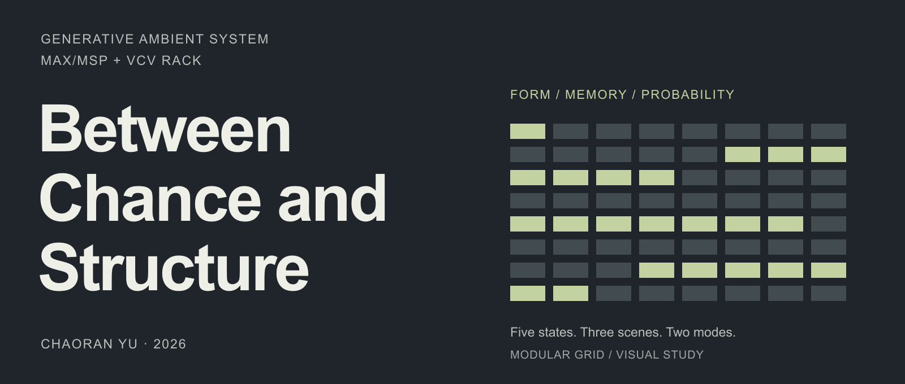
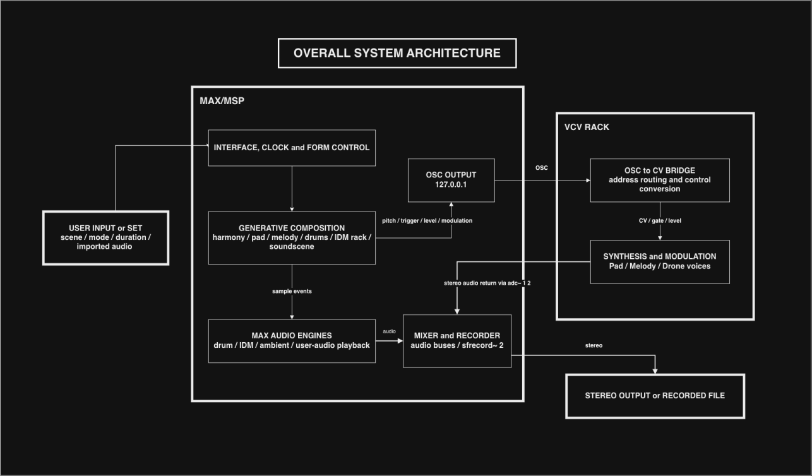

[English](README.md) · **简体中文**

[](https://drive.google.com/file/d/17yuBqAit3PdmheTKZqrVmPnGPdnH5vLY/view?usp=sharing)

**为氛围音乐设计的生成系统**

一套用概率、段落记忆与五状态形式模型，组织长篇氛围音乐和 Lo-fi 材料的生成式系统。

[**观看演示 ↗**](https://drive.google.com/file/d/17yuBqAit3PdmheTKZqrVmPnGPdnH5vLY/view?usp=sharing) · [**试听 ↗**](https://drive.google.com/file/d/1ApeeHdoXmLhVu1l2J4Wy0cETJyLGmT0u/view?usp=sharing) · [**阅读报告**](REPORT.pdf) · [**运行指南**](#运行)

俞超然（Chaoran Yu）· 爱丁堡大学声音设计硕士 · 2026 年 8 月

<details>
<summary>全部演示、技术讲解与录音</summary>

长视频与音频示例托管在 Google Drive，不存放在仓库中。

| 内容 | 文件 | 链接 |
|---|---|---|
| 系统运行的正式演示 | `RunTime.mov` | [在 Google Drive 观看](https://drive.google.com/file/d/17yuBqAit3PdmheTKZqrVmPnGPdnH5vLY/view?usp=sharing) |
| Max/MSP 与 VCV Rack 架构技术讲解 | `Technical_Walkthrough.mov` | [在 Google Drive 观看](https://drive.google.com/file/d/1eXBOXYaxDb0hraimLBJQ85Wr6R3nL45d/view?usp=sharing) |
| 25 分钟连续 Evolve 模式运行 | `Evolve_mode_LongTime.mov` | [在 Google Drive 观看](https://drive.google.com/file/d/1TPtyGSVmoVBKu10N4AeWZmzZfzc1u64b/view?usp=drive_link) |
| 2026 年 8 月 18 日 录制片段 | `2026-08-18_20-17-12.mov` | [在 Google Drive 观看](https://drive.google.com/file/d/1lAIslc-TdbG9T7EG_hM_DVU6XcVMcxPY/view?usp=drive_link) |
| 音频示例 —— Evolve 模式运行 | `EvolveMode_run.wav` | [在 Google Drive 收听](https://drive.google.com/file/d/1ApeeHdoXmLhVu1l2J4Wy0cETJyLGmT0u/view?usp=sharing) |
| 音频示例 —— 用户音频导入测试 | `Example_User_Audio_glasglow_dji.wav` | [在 Google Drive 收听](https://drive.google.com/file/d/16VR578T4fc08Mcy-_fuDGXkPomc4d_qU/view?usp=sharing) |

以上链接均设置为「知道链接的人均可查看」。

</details>

## 我实现的内容

- 五状态形式控制器、Evolve／Timed 模式、段落记忆与声部编排规则。
- 手工编写的和声转移表、加权选择与最小移动声部进行代价函数。
- 旋律和鼓组的乐句记忆、条件 IDM 打击乐、场景环境声，以及与 VCV Rack 的 OSC 集成。

## 工作原理

本项目要回答的问题是：**概率能在多大程度上改变局部的音乐事件，而整体曲式仍不失可读性。**
连续性来自手工编写的规则表、加权选择与段落记忆；变化来自编排层与形式状态的推进。

**五个形式状态**通过每个段落边界的「离开概率」检验依次推进：

`STILL（静止，0）→ EMERGE（浮现，1）→ FLOW（流动，2）→ BLOOM（盛放，3）→ DISSOLVE（消散，4）`

**三个场景**，主要通过各自的样本库与速度池产生区别：Forest（森林）、Rain（雨）、
Steampunk（蒸汽朋克）。

**两种模式** —— *Evolve* 无固定终点；*Timed* 接收一个时长（60–600 秒），把五个状态排在终点
之前并自动停止。

和声使用手工编写的一阶马尔可夫链、加权 `coll` 池与声部进行代价函数；旋律、鼓组与环境事件由
各自的子 patch 驱动。完整架构见报告 4.3–4.5 节，图示见
[`docs/architecture/`](docs/architecture/)。

## 系统架构

<details>
<summary>展开总架构与音频路由</summary>



Max/MSP 负责和声、旋律、鼓组与环境声事件，通过 OSC 将控制数据送往 VCV Rack；
带音高的合成在 VCV Rack 中完成，立体声音频经 BlackHole 返回 Max。

</details>

## 运行

1. 安装 **Max 9.1.4** 与 **VCV Rack 2.6.6**，以及[环境要求](#环境要求)中列出的 VCV 插件。
2. 按[样本替换指南](patch/bpatch_and_samples/samples/README.md)补充 WAV。样本目录初始为空；
   环境声床和 IDM 需要遵循固定的 buffer 分组。
3. 打开 `vcv/Between_Chance_and_Structure.vcv`，把 Audio Interface 设为 **BlackHole 16ch**、
   48 kHz、256 采样块。
4. 打开 `patch/Between_Chance_and_Structure.maxpat`，Max 输入设为 **BlackHole 16ch**，
   输出设为你的实体设备。
5. 启用 Max 音频，选择场景与模式，按 **START**。

不要把 Max 的输出再送回 BlackHole——那会造成反馈或静音。完整的操作手册、界面说明与录音流程见
[`docs/setup-guide.md`](docs/setup-guide.md)。新环境可按[人工验收清单](docs/verification.md)逐项检查。

## 环境要求

项目在 macOS 上开发。作者提供的环境为 macOS Tahoe 26.6.2、16 英寸 MacBook Pro、
Apple M5 Pro、64 GB 内存。详见[环境与 patch 保存的插件版本](docs/environment.md)。
本项目尚未验证 Windows 和 Linux 的音频路由。

- **Max 9.1.4**（开发与测试所用版本）
- **VCV Rack 2.6.6**，并从 VCV Library 安装以下插件：4ms-ROMplers、4msCompany、ALMFree、
  AlrightDevices、Befaco、Bogaudio、DrumKit、HetrickCV、MindMeldModular、NYSTHI、Submit、
  SurgeXTRack、Valley、Venom、trowaSoft
- **BlackHole 16ch**（或同类虚拟音频设备），用于把 VCV Rack 的音频送回 Max
- 一副实体输出（耳机、音箱或声卡）

## 项目报告

[](REPORT.pdf)

[**Between Chance and Structure —— 项目报告（PDF，55 页）**](REPORT.pdf)

报告是主要的文字成果：动机与相关实践、手工编写的规则系统、五状态形式模型、
Max/MSP 与 VCV Rack 的实现、试听与反思，以及三个附录（AI 使用声明、第三方素材、
概率与映射表）。

## 仓库结构

<details>
<summary>展开目录树</summary>

```
README.md                     本页
README.zh-CN.md               简体中文版
REPORT.pdf                    项目报告全文（55 页，含附录）
NOTICE.md                     版权与使用条款
llms.txt                      给 AI 工具用的机器可读索引
docs/
    environment.md            作者环境与保存的插件版本
    verification.md           静态检查、作者确认与可选检查
    release-notes.md          v1.0 候选版发布说明
    setup-guide.md            操作手册：音频路由、界面、录音
    credits-and-materials.pdf 第三方软件、插件与音频素材来源
    visuals/                  首页封面与可编辑 SVG
    architecture/             系统架构图
    ai-assistant-guide.md     写给 AI 助手的安装说明
patch/
    Between_Chance_and_Structure.maxpat   Max 主 patch
    bpatch_and_samples/                   Max 抽象与样本目录
        AmbientEventVoice.maxpat
        IDMPercVoice.maxpat
        drumRack.maxpat / drumRack_64.maxpat
        globalClock.maxpat
        samples/
            README.md         原样本内容清单（按目录）
            PROVENANCE.md     已知来源、Sound ID 与追溯缺口
            IDM_samples/  drums/{kick,snare,hat,ohat,cymbals}/  sceneAmbient/  sceneEvents/
vcv/
    Between_Chance_and_Structure.vcv      VCV Rack 合成 patch
```

Max patch 以自身位置为基准解析 `bpatch_and_samples/`，因此
`Between_Chance_and_Structure.maxpat` 与这个目录必须保持同级。

</details>

## 未包含的内容

- **样本库** —— 原始音频来自商业采样包与实地录音，无法在此重新分发。目录随仓库空置，patch
  可以打开，但采样声部需要自行补充音频。请按[样本替换指南](patch/bpatch_and_samples/samples/README.md)
  准备素材：环境声床须按场景分为三组各五个，IDM 须按五类音色填满 1–57 号 buffer，并检查加载顺序。
  该指南保留原始文件清单；`samples/PROVENANCE.md` 记录已知来源、Sound ID 与追溯缺口。
  这些库授权的是**在作品中使用**（含商业发行），
  而不是**再分发原始文件**。
- **视频与音频示例** —— 见上方 Google Drive 链接。

## 交给 AI 助手来装

如果希望让 AI 助手带着你（或由它自己）完成安装，把下面这行贴给它：

```
Read https://raw.githubusercontent.com/Chora666/between-chance-and-structure/main/docs/ai-assistant-guide.md and help me get Between Chance and Structure running.
```

这份文件是专门写给 AI 助手的安装说明：要克隆什么、装哪些 VCV 插件、音频怎么路由、如何验证、
以及通常会在哪里卡住。[`llms.txt`](llms.txt) 用 llms.txt 格式给出同样的入口。

## 致谢

所用第三方软件、插件、VCV Rack 模块、音频素材库与录音硬件见
[`docs/credits-and-materials.pdf`](docs/credits-and-materials.pdf)。报告中附录 A 说明了开发
过程中使用 AI 辅助工具的情况。

## 许可

- **代码与 patch** —— [PolyForm Noncommercial 1.0.0](LICENSE.md)。非商业用途免费：
  学习、教学、研究、个人项目、非商业演出与展览。**商业使用需单独取得授权**（见下）。
- **文档与报告** —— [CC BY-NC 4.0](https://creativecommons.org/licenses/by-nc/4.0/)。
  需署名，仅限非商业使用。

用这套系统做出的音乐属于你自己的作品，不构成源码的衍生作品，因此上述许可不涉及你的录音。

商业授权请联系：在 [issue 区](https://github.com/Chora666/between-chance-and-structure/issues)
开一个 issue，或在 GitHub 上联系 [@Chora666](https://github.com/Chora666)。
引用格式与致谢写法见 [NOTICE.md](NOTICE.md)。第三方素材保留各自的授权，不在此重新授权。
